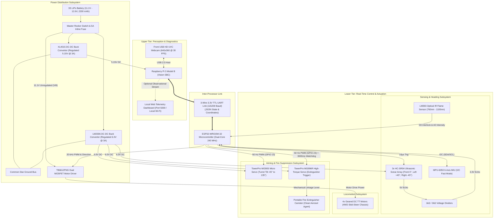

# SAGIP-X: Complete Technical System Architecture

## 1. Architectural Philosophy and Design Principles

The SAGIP-X mobile firefighting robot is engineered for rapid, autonomous fire localization, corridor navigation, obstacle avoidance, and mechanical chemical suppression in indoor residential environments.

To achieve robust performance without relying on high-cost industrial robotics hardware or fragile cloud connections, SAGIP-X is structured around three core architectural tenets:

1. **Decoupled Dual-Tier Processing:** Computer vision processing (color space thresholding, video frame buffering, and neural object classification) is non-deterministic and computationally demanding. If a single microcontroller attempts to process 30 FPS video while generating motor PWM and timing microsecond ultrasonic echo pulses, frame processing lags can delay collision reactions, resulting in physical wall impacts. SAGIP-X strictly decouples high-level perception (handled by a Linux-based Raspberry Pi 3B single-board computer) from low-level real-time motion and safety actuation (handled by an ESP32-WROOM-32 microcontroller).
2. **100% Offline Autonomy:** In residential fire emergencies, power mains often trip and home Wi-Fi routers lose electrical power. SAGIP-X does not depend on cloud APIs, internet connectivity, or remote operator control. All video inference, ultrasonic collision avoidance, state logic, and suppression decisions execute completely on physical hardware.
3. **Multi-Modal Fire Confirmation Interlock:** To prevent catastrophic false discharges caused by sunlight reflections, halogen lamps, or incandescent bulbs, suppression can never be triggered by the optical camera alone. The system requires concurrent verification across two independent physical sensing domains: optical bounding-box tracking from the camera and physical electromagnetic radiation confirmation (760 nm to 1100 nm) from an onboard LM393 infrared flame sensor at a safe standoff distance of 30.0 cm.

---

## 2. System Architecture Diagram

---

## 3. Subsystem Breakdown and Interfacing

### A. High-Level Vision Tier (Raspberry Pi 3 Model B)
- **Role:** Handles computer vision frame acquisition, optical flame detection, temporal multi-frame confirmation, and diagnostic telemetry streaming.
- **Video Capture:** Pulls 640x360 color video frames at 30 FPS over USB from a standard UVC webcam using Linux V4L2 drivers.
- **Vision Pipeline:** Frames are converted to HSV color space for luminous intensity segmentation. A quantized neural flame detector analyzes candidate bounding boxes. To eliminate flicker and transient glare, a 5-frame sliding window requires confirmed detections in at least 3 consecutive frames before asserting target presence.
- **Diagnostic Telemetry Interface:** An asynchronous Flask HTTP server streams an MJPEG video feed overlaid with detection bounding boxes, target crosshairs, confidence ratings, and state machine status to local developers on port 5000 (`http://<pi-ip>:5000/`).

### B. Low-Level Control Tier (ESP32-WROOM-32)
- **Role:** Executes hard real-time motor control, round-robin ultrasonic sensor sampling, sensor signal conditioning, turret elevation, and mechanical extinguisher actuation.
- **Multitasking:** The ESP32 utilizes hardware timer interrupts to sample sensors deterministically. Motor PWM frequencies are set to 20 kHz to eliminate human-audible coil squeal and maximize motor torque efficiency.
- **Firmware Signal Conditioning:** Distance measurements from the three HC-SR04 ultrasonic sensors pass through a 3-sample rolling median filter, rejecting acoustic multi-path reflections and stray echoes before obstacle avoidance algorithms evaluate clearances.
- **Motor Slew Limiting:** Low-level motor drivers apply acceleration ramps and deadband compensation, preventing sudden current surges that could drop battery voltage below microcontroller brownout thresholds.

### C. Mechanical Fire Suppression Subsystem
- **Extinguisher Canister:** A commercially manufactured portable fire extinguisher can containing non-conductive aerosol/dry-chemical agent, mounted securely to the rear chassis.
- **Mechanical Trigger Actuator:** A TowerPro MG996R metal-gear servo delivering up to 11 kg-cm stall torque is mounted adjacent to the canister release lever. A custom aluminum linkage arm couples the servo horn to the valve lever.
- **Failsafe Firmware Watchdog:** When triggered via ESP32 GPIO 23, the servo arm rotates to 90 degrees, physically depressing the canister valve for exactly 3.0 seconds. An internal 3000 ms hardware timer guarantees that the servo returns to 0 degrees (valve closed) even if the communication link crashes or a software loop hangs.

### D. Power Subsystem and Ground Isolation
- **Primary Power:** 11.1V (12.6V fully charged) 3S LiPo battery pack rated at 2200 mAh with 25C continuous discharge capability.
- **Safety Disconnect:** An SPST high-current master rocker switch and a 5A fast-blow inline fuse protect the battery against dead short-circuits.
- **Independent Buck Regulators:**
  1. **XL4015 Buck Converter:** Tuned to 5.15V DC (3A peak) to power the Raspberry Pi 3B via header pins, eliminating low-voltage CPU throttling.
  2. **LM2596 Buck Converter:** Tuned to 6.0V DC (3A peak) to power the high-torque MG996R trigger servo, MG90S tilt servo, and ultrasonic sensors.
- **Star Ground Architecture:** Motor return currents flow directly to the battery negative terminal through heavy-gauge copper wiring, completely isolated from sensitive digital microcontroller ground paths to eliminate ground bounce.

---

## 4. Hardware Pinout and Electrical Connections

| SBC / Controller | Pin Identifier | Connected Hardware Module | Signal Direction | Electrical Standard & Protection |
|---|---|---|:---:|---|
| **Raspberry Pi 3B** | GPIO 14 (Pin 8) | ESP32 GPIO 16 (RX2) | Output | 3.3V TTL UART TX (115200 baud) |
| **Raspberry Pi 3B** | GPIO 15 (Pin 10) | ESP32 GPIO 17 (TX2) | Input | 3.3V TTL UART RX (115200 baud) |
| **Raspberry Pi 3B** | USB Port 1 | USB UVC Web Camera | Bidirectional | USB 2.0 Host (640x360 @ 30 FPS) |
| **ESP32-WROOM-32** | GPIO 16 | Raspberry Pi GPIO 14 (TXD0) | Input | 3.3V TTL UART RX2 |
| **ESP32-WROOM-32** | GPIO 17 | Raspberry Pi GPIO 15 (RXD0) | Output | 3.3V TTL UART TX2 |
| **ESP32-WROOM-32** | GPIO 34 | LM393 Optical Flame Sensor D0 | Input | 3.3V GPI Input Only (Active LOW on fire) |
| **ESP32-WROOM-32** | GPIO 14 | MPU-6050 6-Axis IMU (SDA) | Bidirectional | I2C Fast Mode (400 kHz, 3.3V) |
| **ESP32-WROOM-32** | GPIO 15 | MPU-6050 6-Axis IMU (SCL) | Output | I2C Clock (400 kHz Fast Mode, 3.3V) |
| **ESP32-WROOM-32** | GPIO 4 | Front HC-SR04 Trigger | Output | 3.3V 10µs Trigger Pulse |
| **ESP32-WROOM-32** | GPIO 36 | Front HC-SR04 Echo (SENSOR_VP)| Input | 3.3V (via 1kΩ / 2kΩ Voltage Divider) |
| **ESP32-WROOM-32** | GPIO 32 | Left HC-SR04 Trigger | Output | 3.3V 10µs Trigger Pulse |
| **ESP32-WROOM-32** | GPIO 39 | Left HC-SR04 Echo (SENSOR_VN) | Input | 3.3V (via 1kΩ / 2kΩ Voltage Divider) |
| **ESP32-WROOM-32** | GPIO 33 | Right HC-SR04 Trigger | Output | 3.3V 10µs Trigger Pulse |
| **ESP32-WROOM-32** | GPIO 35 | Right HC-SR04 Echo | Input | 3.3V (via 1kΩ / 2kΩ Voltage Divider) |
| **ESP32-WROOM-32** | GPIO 25 | TB6612FNG PWMA (Left Motors) | Output | 20 kHz Hardware PWM Channel |
| **ESP32-WROOM-32** | GPIO 26 | TB6612FNG AIN1 (Left Direction)| Output | 3.3V Logic Level |
| **ESP32-WROOM-32** | GPIO 27 | TB6612FNG AIN2 (Left Direction)| Output | 3.3V Logic Level |
| **ESP32-WROOM-32** | GPIO 18 | TB6612FNG PWMB (Right Motors)| Output | 20 kHz Hardware PWM Channel |
| **ESP32-WROOM-32** | GPIO 19 | TB6612FNG BIN1 (Right Dir 1) | Output | 3.3V Logic Level |
| **ESP32-WROOM-32** | GPIO 21 | TB6612FNG BIN2 (Right Dir 2) | Output | 3.3V Logic Level |
| **ESP32-WROOM-32** | GPIO 22 | TB6612FNG STBY (Driver Enable)| Output | 3.3V Active HIGH Standby Pin |
| **ESP32-WROOM-32** | GPIO 13 | TowerPro MG90S Tilt Servo | Output | 50 Hz PWM (1.0 ms to 2.0 ms pulse) |
| **ESP32-WROOM-32** | GPIO 23 | TowerPro MG996R Extinguisher | Output | 50 Hz PWM with 3000ms Watchdog |
