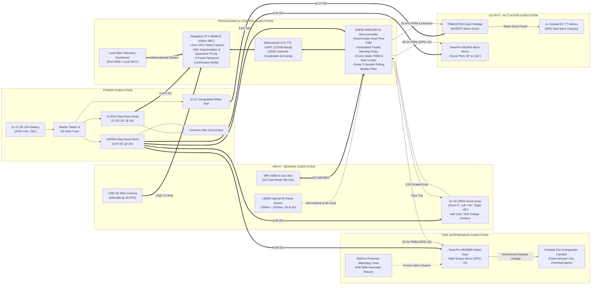

# SAGIP-X: System Block Diagram and Subsystem Specifications

---

## 1. High-Resolution System Block Diagram


*(The high-resolution diagram image is saved in your project root at [`system_block_diagram.jpg`](file:///C:/Users/danda/.gemini/antigravity/worktrees/proud-babbage/v2_navigation_model/system_block_diagram.jpg)).*

---

## 2. Interactive Mermaid Block Diagram



---

## 3. Standard Academic ASCII Block Diagram

```
=======================================================================================================================
                                      SAGIP-X SYSTEM FUNCTIONAL BLOCK DIAGRAM
=======================================================================================================================

   +---------------------------------------+
   |            POWER SUBSYSTEM            |
   |                                       |
   |  [ 11.1V 3S LiPo Battery 2200mAh ]    |
   |                   |                   |
   |         [ Master Switch & 5A Fuse ]   |
   |                   |                   |
   |  +----------------+----------------+  |
   |  |                |                |  |
   |  v                v                v  |
   | [XL4015]      [LM2596]        [VM Rail]|
   | (5.15V)       (6.0V)          (11.1V) |
   |    |              |                |  |
   +----+--------------+----------------+--+
        |              |                |
        |              +--------+       |
        |                       |       |
        v                       v       v
   +--------------------+  +--------------------+       +------------------------------------+
   |   UPPER TIER:      |  |    LOWER TIER:     |       |    OUTPUT / ACTUATION SUBSYSTEM    |
   |   RASPBERRY PI 3B  |  |   ESP32-WROOM-32   |       |                                    |
   |                    |  |                    |       |  +------------------------------+  |
   | [USB HD Webcam]    |  | [3x HC-SR04 Sonar] |       |  | TB6612FNG Dual Motor Driver  |  |
   |       | (USB Host) |  |   (with Dividers)  |       |  |              |               |  |
   |       v            |  |         |          |       |  |              v               |  |
   | [Color Threshold & |  |         v          |       |  |  [ 4x DC TT Geared Motors ]  |  |
   |  Quantized Neural] |  | [Median Filter &   |       |  +------------------------------+  |
   |       |            |  |  TinyML Nav Engine]|       |                                    |
   |       v            |  |         |          |       |  +------------------------------+  |
   | [5-Frame Buffer]   |  |         v          |       |  | TowerPro MG90S Micro Servo   |  |
   |       |            |  | [LM393 IR Sensor]  |       |  | (Turret Pitch: 45° to 135°)  |  |
   |       |            |  | [MPU-6050 6-X IMU] |       |  +------------------------------+  |
   |       |            |  |         |          |       +------------------------------------+
   |       |            |  |         v          |                          ^
   |       |            |  | [FSM State Engine] |                          | (20kHz PWM / GPIO 13)
   |       v            |  |         |          |--------------------------+
   | [Web Dashboard]    |  |         |          |
   |  (Port 5000 HUD)   |  |         |          |--------------------------+
   +--------+-----------+  +---------+----------+                          | (GPIO 23 PWM + Watchdog)
            ^                        ^                                     v
            |                        |                  +------------------------------------+
            +== [ 3-Wire UART Link ] =+                  |     FIRE SUPPRESSION SUBSYSTEM     |
                (115200 Baud / JSON)                    |                                    |
                                                        |  [ TowerPro MG996R Torque Servo ]  |
                                                        |                  |                 |
                                                        |  [ Mechanical Lever Arm Linkage ]  |
                                                        |                  |                 |
                                                        |                  v                 |
                                                        |  [ Portable Extinguisher Canister ]|
                                                        |  [ 3000ms Safety Watchdog Timer ]  |
                                                        +------------------------------------+
=======================================================================================================================
```

---

## 4. Subsystem Functional Breakdown

### 1. Power Distribution Subsystem
- **Battery Source:** 11.1V nominal (12.6V fully charged) 3S Lithium-Polymer (LiPo) battery rated at 2200 mAh with 25C continuous discharge rating.
- **Protection:** Inline 5A fast-acting fuse and a high-current SPST rocker switch providing immediate mechanical power cutoff.
- **XL4015 Switching Regulator:** Converts 11.1V down to a clean, stable 5.15V DC rail delivering up to 3A to the Raspberry Pi 3B via GPIO pins 2 and 4, preventing low-voltage CPU throttling.
- **LM2596 Switching Regulator:** Converts 11.1V down to a regulated 6.0V DC rail delivering up to 3A dedicated to powering the two servo motors (MG996R trigger and MG90S tilt) and the three HC-SR04 ultrasonic sensors.
- **Direct 11.1V Motor Rail:** Unregulated battery voltage feeds directly into the VM motor rail of the TB6612FNG driver to maximize wheel torque.
- **Star Ground Topology:** All ground returns converge at a single star point on the chassis terminal block to isolate motor commutation electrical noise from sensitive digital logic.

### 2. Input / Sensing Subsystem
- **USB HD Web Camera:** Connects directly to the Raspberry Pi USB 2.0 host port, capturing color frames at 640x360 resolution at 30 FPS with a 65-degree horizontal field of view.
- **3x HC-SR04 Ultrasonic Sonar Array:** Positioned at Front (0°), Left (+45°), and Right (-45°) for spatial obstacle detection. The sensors emit 40 kHz acoustic bursts upon receiving 10 µs trigger pulses from ESP32 GPIOs 5, 19, and 22. Returning 5V Echo signals are shifted down to 3.3V using passive resistive dividers ($R_1 = 1\text{k}\Omega, R_2 = 2\text{k}\Omega$) connected to ESP32 GPIOs 18, 21, and 4.
- **LM393 Optical IR Flame Sensor:** Positioned co-axially on the articulated turret, detecting radiation from 760 nm to 1100 nm. The digital output (D0) connects to ESP32 GPIO 32 as an active-LOW physical interlock, while the analog output (A0) connects to ESP32 GPIO 33 (ADC1 Channel 5) for radiant intensity measurement.
- **MPU-6050 6-Axis Inertial Measurement Unit:** Communicates with the ESP32 over I2C Fast Mode (400 kHz) on GPIO 14 (SDA) and GPIO 15 (SCL), providing chassis angular yaw velocity to stabilize differential drive steering.

### 3. Processing and Control Subsystem
- **Decoupled Architecture:** Separates compute-intensive, asynchronous computer vision on the Raspberry Pi 3B from hard real-time motor control, ultrasonic timing, and actuator execution on the ESP32-WROOM-32.
- **Inter-Processor Serial Interface:** 3-wire 3.3V TTL UART operating at 115200 baud (Pi GPIO 14 TX to ESP32 GPIO 16 RX; Pi GPIO 15 RX to ESP32 GPIO 17 TX; Common Ground). Data packets use compact, checksummed JSON format encoding target centroid coordinates $(x, y)$ and operational state events.
- **Firmware Signal Processing:**
  - 3-sample rolling median filter on each ultrasonic channel to eliminate acoustic multi-path reflections.
  - Embedded TinyML neural steering policy (`navigation_model.h`, 818 parameters, <4 KB RAM footprint) calculating smooth motor PWM adjustments.
  - Slew-rate acceleration limiting in `motor_controller.cpp` to prevent voltage brownout dips.
- **Developer Telemetry HUD:** An asynchronous Flask streaming server (`bantay_sunog/monitoring/web_stream.py`) hosted on the Pi on port 5000 (`http://<pi-ip>:5000/`) allows developers and evaluators to observe live video, bounding boxes, target crosshairs, and sensor telemetry wirelessly over local Wi-Fi.

### 4. Output / Actuation Subsystem
- **TB6612FNG Dual H-Bridge Motor Driver:** High-efficiency MOSFET driver delivering 1.2A continuous (3.2A peak) per channel. Driven by 20 kHz hardware PWM channels from ESP32 GPIO 25 (PWMA) and GPIO 2 (PWMB), with direction control on GPIOs 26, 27, and 12.
- **4x DC TT Geared Motors:** Four brushed DC permanent magnet motors with a 1:48 reduction gearbox driving rubber traction wheels in a 4WD differential skid-steer configuration.
- **TowerPro MG90S Micro Servo:** Metal-gear micro servo connected to ESP32 GPIO 13, driving the single-axis vertical pitch of the camera and flame sensor turret across an angular range of 45° downward to 135° upward.

### 5. Fire Suppression Subsystem
- **Portable Fire Extinguisher Canister:** Commercially manufactured portable extinguisher canister carrying non-conductive clean aerosol/dry-chemical extinguishing agent suitable for Class A, B, and electrical fires.
- **TowerPro MG996R High-Torque Servo:** Metal-gear servo delivering up to 11 kg-cm stall torque at 6.0V, mounted to a rigid bracket adjacent to the canister release lever and driven by ESP32 GPIO 23.
- **Mechanical Actuation:** Rotating the servo arm to 90 degrees pulls an aluminum linkage arm that physically depresses the extinguisher valve.
- **3000ms Firmware Watchdog Timer:** An internal hardware timer on the ESP32 enforces an exact 3.0-second maximum discharge window, automatically returning the servo arm to 0 degrees (valve closed) to prevent full canister depletion or accidental discharge.
